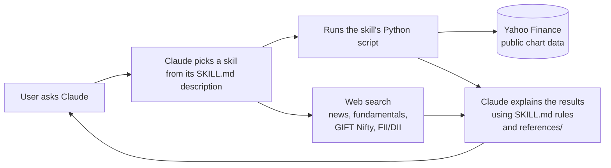

# Architecture

## Design goals

1. **Zero setup**: no API keys, no third-party Python packages, works on Windows, macOS and Linux.
2. **Honest**: numbers come from code or cited sources, never from the model's memory.
3. **Explainable**: every score is a simple rule a beginner can understand.
4. **Safe**: read-only, no broker access, no buy/sell calls.

## How a request flows

| Layer | What it does | Where |
|-------|--------------|-------|
| **SKILL.md** | Tells Claude *when* to use the skill (frontmatter `description`) and *how* (steps, rules, output format) | `skills/<name>/SKILL.md` |
| **Scripts** | Deterministic math: trends, RSI, ATR, returns, sector ranking, position size, charges | `skills/<name>/scripts/` |
| **Data helper** | Fetches prices, maps symbols, computes indicators | `shared/india_data.py` (copied into each skill) |
| **References** | Glossaries, playbooks and templates the skill reads when needed | `skills/<name>/references/` |
| **Web search** | Fundamentals, news, flows, lot sizes, always cited | Claude's built-in tools |

## Why the data helper is copied into every skill

Users often install a single skill. A skill must work on its own, so each one ships its own copy of
`india_data.py`. The canonical copy is `shared/india_data.py`. `make sync` copies it, and a unit test fails if any
copy drifts.

## Data sources and limits

| Data | Source | Notes |
|------|--------|-------|
| Index and stock prices (daily) | Yahoo Finance chart endpoint | May be ~15 min delayed. Some indices (e.g. Nifty Media) have gaps and are skipped |
| Fundamentals | Web search (Screener.in, company filings, NSE/BSE) | Yahoo's fundamentals endpoint needs a login, so it isn't used |
| GIFT Nifty, FII/DII, news | Web search | Cited with date |
| F&O lot sizes | Web search (NSE) | Never hard-coded, because NSE revises them |
| Trading charges | Constants in `position_size.py` | Approximate. `RATES_AS_OF` marks when they were last reviewed |

NSE's own website isn't scraped, because its terms restrict automated access.

## Testing

`tests/test_offline.py` runs without network access and covers indicators, symbol mapping, market hours,
position-sizing math, sector labels, trend rules, SKILL.md frontmatter, file references, the skills index and helper-copy
sync. CI runs it on Linux, macOS and Windows with Python 3.9 and 3.12, plus a ruff lint.
